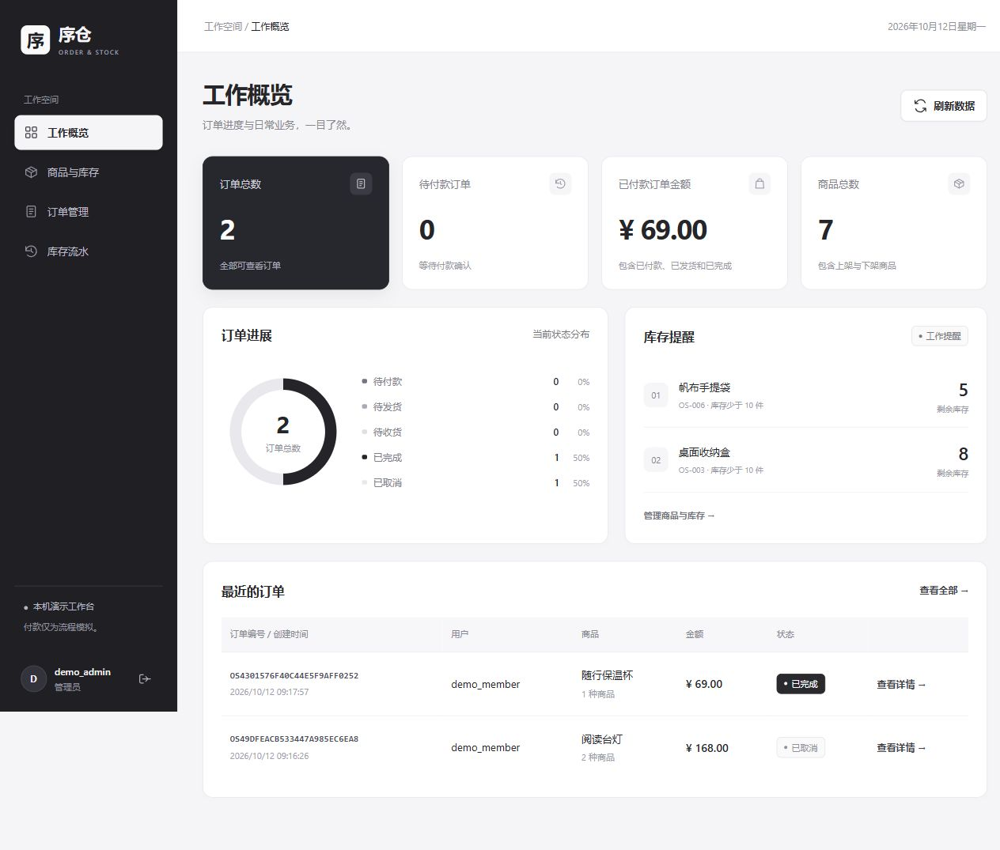

# 序仓 订单与库存管理系统

序仓是一个用于练习 Python 后端开发的完整单体业务项目。管理员维护商品与库存、查看全部订单并确认发货；普通用户浏览商品、创建订单、模拟付款、取消待付款订单并确认收货。每次库存变动都有流水记录。

后端使用 Flask、Blueprint、SQLAlchemy ORM 和关系型数据库；前端使用原生 HTML、CSS、JavaScript，通过同源 JSON 接口与后端交互。业务判断、金额计算、权限检查和事务都在后端完成。



## 后端实现方式

`app.py` 直接创建 Flask 实例，再注册各功能 Blueprint。路由通过普通函数读取登录用户，管理员权限使用 `if` 判断；基础查询与新增使用 ORM，库存扣减和状态变更使用 `db.session.execute(text(...), 参数字典)` 执行参数化 SQL。

未使用应用工厂、自定义权限装饰器或显式行锁 API。库存条件、原订单状态、唯一约束及 `commit()/rollback()` 共同维护业务一致性。重复提交编号、金额 `Decimal` 和页面请求凭证属于少量通用辅助逻辑。

## 第一次使用

1. 在项目目录双击 `启动项目.cmd`。
2. 保持启动窗口打开，在浏览器访问 `http://127.0.0.1:5010`。
3. 用记事本打开项目目录的 `demo_accounts.txt`，查看自动生成的演示账号与密码。
4. 管理员账号为 `demo_admin`，普通用户账号为 `demo_member`。也可以直接在网页注册普通用户。
5. 完成操作后，在启动窗口按 `Ctrl+C` 关闭服务。

首次运行会升级本项目数据库结构并加入六种演示商品。再次运行不会清空订单、重置密码或覆盖已有商品。不要同时启动两个服务进程。

默认使用 `instance/order_stock.db` 这个独立 SQLite 文件，方便先体验功能。该文件与旧成绩管理项目的数据没有联系。本机演示不需要你提供 MySQL 密码，也不需要购买服务器。

如果 `.venv` 不存在，启动脚本会创建环境并安装依赖；电脑需要安装 Python 3.10 或更新版本，并能联网下载依赖。当前项目使用 Python 3.14 验证。

## 业务流程与规则

```text
创建订单 → 待付款 → 模拟付款 → 待发货 → 管理员确认发货 → 待收货 → 确认收货 → 已完成
                ↓
           取消订单 → 已取消，归还库存
```

- 下单即扣库存，待付款订单不会自动超时关闭。
- 只有待付款订单可以取消；已付款订单的退款流程不属于此版本。
- 取消操作可重复调用，但库存只恢复一次。
- 普通用户只可查看及操作自己的订单；管理员可以管理全部订单。
- 普通用户不能创建管理员、修改商品、调整库存或发货。
- 商品历史成交名称、SKU、单价及金额随订单保存。修改商品价格不改变旧订单。
- 商品采用上下架管理，保留商品及订单历史，不提供直接物理删除接口。
- 商品金额使用 `Decimal` 与数据库 `Numeric`，后端根据商品价格计算金额；拒绝客户端提交总价。
- 一个订单最多 50 种商品，同种商品合并后提交；单种数量为 1 至 100000。
- 创建订单使用提交编号与数据库唯一约束防止相同请求重复扣库存；同一编号不得用于不同订单内容。
- 多商品订单的库存扣减、订单明细及流水在一个事务中提交，任何一步失败都会回滚。
- 商品库存以带条件的更新语句扣减；订单状态以带原状态条件的更新语句改变，防止重复执行。
- 日期筛选以 UTC 日历日期为边界，界面显示为浏览器本地时间。时间字段为带 `Z` 的 UTC 时间。
- 模拟付款仅改变订单状态，没有真实扣款，也没有支付渠道。

## 切换到 MySQL

先在 MySQL 中创建一个新的空数据库，不要使用已有的成绩管理数据库：

```sql
CREATE DATABASE order_stock CHARACTER SET utf8mb4 COLLATE utf8mb4_unicode_ci;
```

在项目 `.env` 中填写以下内容。数据库密码只保存在你自己的电脑，不要发到聊天、截图或公开仓库。

```dotenv
USE_MYSQL=1
DB_HOST=127.0.0.1
DB_PORT=3306
DB_USER=root
DB_PASSWORD=你的本机数据库密码
DB_NAME=order_stock
DATABASE_URL=
```

然后关闭原有启动窗口，重新双击 `启动项目.cmd`。启动脚本会把迁移应用到新的 MySQL 数据库；不会把旧 SQLite 数据搬过去，两个库分别保留。演示账号首次在每个库生成，最新新增账号记录会追加到 `demo_accounts.txt`，请使用对应库首次启动时产生的密码。

连接代码通过 `quote_plus` 处理账号、密码中的特殊字符，再构造 MySQL 连接地址。`.env`、演示密码和数据库文件均已加入 `.gitignore`。

本版本已用 SQLite 完成功能测试；MySQL 连接与实际锁行为需要在你的 MySQL 环境中继续验证。两个并发请求的测试是基本一致性检查，不是高并发性能或生产可靠性的证明。

## 项目结构

```text
app.py                 应用入口
store/
  __init__.py          模块目录说明
  extensions.py        数据库与迁移扩展
  models.py            用户、商品、订单、订单明细、库存流水
  common.py            参数校验、登录查询函数、分页、JSON 响应
  auth.py              注册、登录、退出、当前登录用户
  products.py          商品管理、库存调整、库存流水
  orders.py            下单、查询、取消及订单状态流转
  dashboard.py         订单状态分布与金额统计
migrations/            数据库结构迁移
templates/index.html   工作台页面
static/                页面样式和接口调用
tests/test_api.py      后端功能与基本并发一致性测试
docs/接口说明.md       接口与请求示例
docs/验收记录.md       验证结果及未验证范围
start.ps1              初始化并启动本机服务
启动项目.cmd           Windows 双击启动入口
```

## 开发与测试

在项目目录打开 PowerShell：

```powershell
.\.venv\Scripts\python.exe -m unittest discover -s tests -v
.\.venv\Scripts\python.exe -m flask --app app db upgrade
.\.venv\Scripts\python.exe -m flask --app app seed-demo
.\.venv\Scripts\python.exe -m flask --app app run --host 127.0.0.1 --port 5010
```

修改模型之后，使用 `flask db migrate -m "说明"` 生成迁移，检查内容后再 `flask db upgrade`。初始化迁移已经放入项目，无需再次执行 `db init`。

测试使用临时 SQLite 数据库；不会写入演示数据库或个人 MySQL 数据库。

## 使用边界

该项目已实现上述本机演示业务，不包含真实支付、退款、物流接口、邮件通知和自动关闭超时订单。Flask 自带服务器仅用于本机开发；公网部署需要另行配置服务器、HTTPS 和运行服务。

本项目用于 Python 后端练习，开发过程中使用 Codex 辅助编写代码及实现界面。已实现功能与测试结果以项目代码和验收记录为准。
